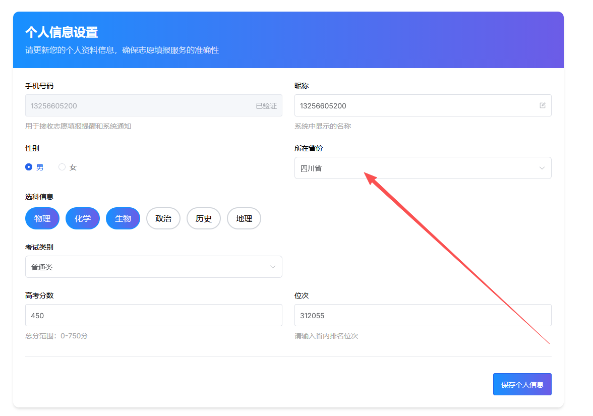

## 一、 注册/登录（SignIn）、查询个人信息（MyuserInfoQuery）接口 字段新增
新增3个业务字段，字段说明如下表所示：

| 字段名 | 取值说明 | 备注 |
| ---- | ---- | ---- |
| xkMod | 1: 3+3模式；2: 3+1+2模式；0: 未知 | 选科模式标识 |
| ifProvSave | 0: 未完善省份信息；1: 已完善省份信息 | 省份信息完善状态标识 |
| ifUserActive | 0: 未完善成绩信息；1: 已完善成绩信息 | 成绩信息完善状态标识 |

## 二、 登录/查询个人信息后 业务流程
1.  登录接口（SignIn）或查询个人信息接口（MyuserInfoQuery）调用完成后，校验`ifProvSave`字段值
2.  若`ifProvSave = 0`，**强制跳转至选择省份页面**
    - 调用`UserProvQuery`接口，获取系统可用省份列表
    - 用户选择省份后，调用`MyUserPorvSave`接口保存省份信息
    - 后台接收到保存请求后，自动将`ifProvSave`字段值更新为`1`

## 三、 二次查询个人信息 业务流程
1.  完成省份信息保存后，再次调用查询个人信息接口（MyuserInfoQuery）
2.  校验`ifUserActive`字段值，若`ifUserActive = 0`，**强制跳转至填写个人信息页面**
3.  填写个人信息页面 限制规则
    - 若`remaineditnum < 1`：超过修改次数限制，禁止修改成绩信息
    - 若`ifEditPhone = 0`：禁止修改手机号
    - 若`xkMod = 1`（3+3模式）：遵循 **6选3** 选课规则
    - 若`xkMod = 2`（3+1+2模式）：需同时遵循以下两条规则
      1.  物理、历史两门科目中**必选1门**
      2.  从剩余四门科目中**选择2门**
4.  个人信息（含成绩、选课信息）提交后，后台自动将`ifUserActive`字段值更新为`1`

## 四、 省份选择界面 下拉框 改为 标签选择
